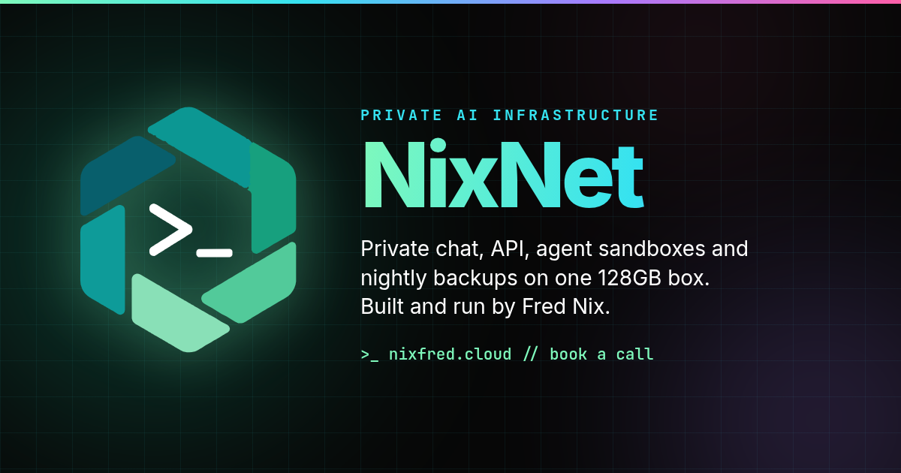
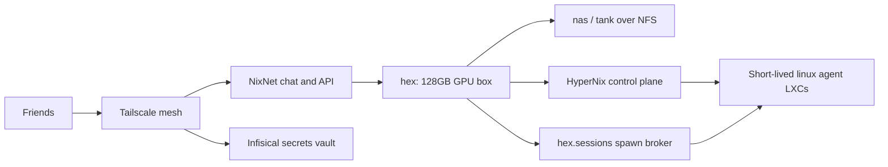

<p align="center">
  
</p>

<p align="center">
  
</p>

<p align="center">
  <a href="https://nixfred.cloud/"></a>
  
  
</p>

# nixfred.cloud

The public story page for **NixNet**, Fred Nix's private GPU lab for a small circle of friends: browser chat and an OpenAI-compatible API over Tailscale, shared nas storage, and short-lived agent sandboxes on one 128GB homelab box. The real service stays on the tailnet; this page just tells the story.



## Layout

| Path | What |
|---|---|
| `public/` | The whole site. Hand-written HTML, CSS and a little JS, no framework, no build. |
| `public/brand/` | The locked nixfred hexagon files, copied unmodified. |
| `public/llms.txt` | Plain-text summary for agents. No fake endpoints. |
| `tools/diagram.py` | Generates the inline SVG flowchart (wide and mobile layouts). |
| Cloudflare Pages | Project `nixfred-cloud` is Git-connected: push to `main` deploys `public/` (no build step). |

The old snowstorm landing page lives on the [`snowstorm-archive`](../../tree/snowstorm-archive) branch and at [storm.nixfred.com](https://storm.nixfred.com/).

## Run locally

```
cd public && python3 -m http.server
```

Animations switch off for anyone with `prefers-reduced-motion` set.
