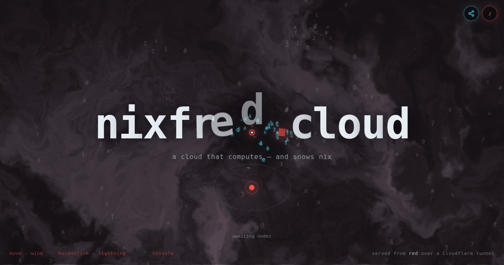
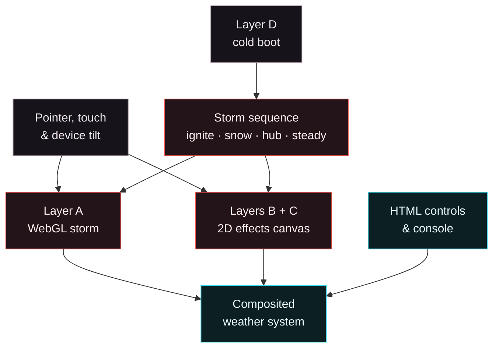
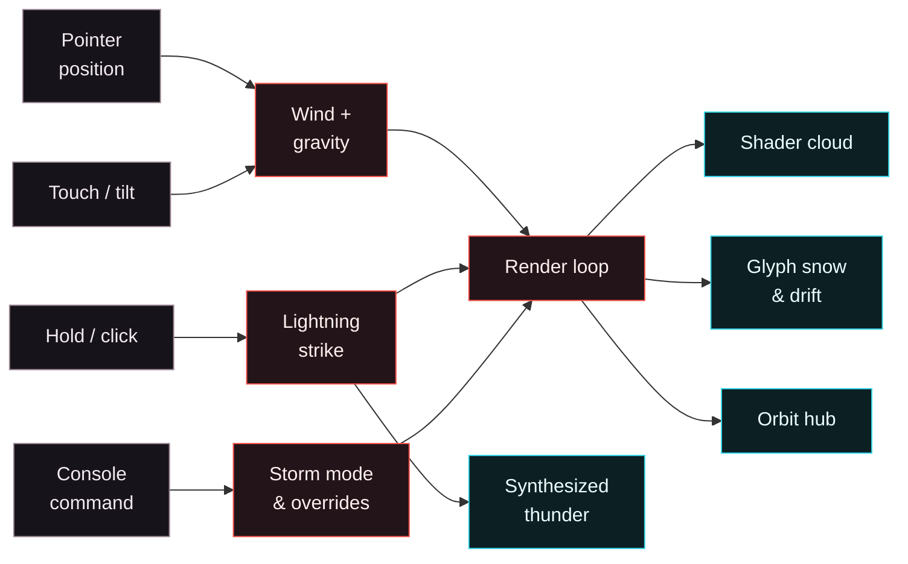
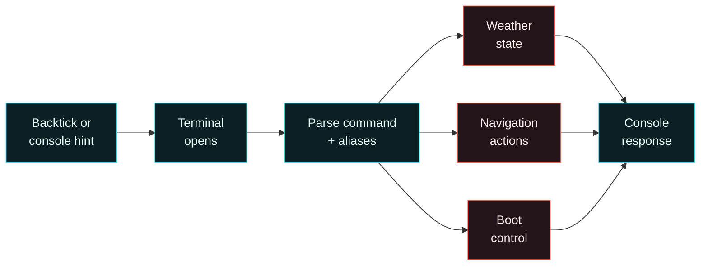
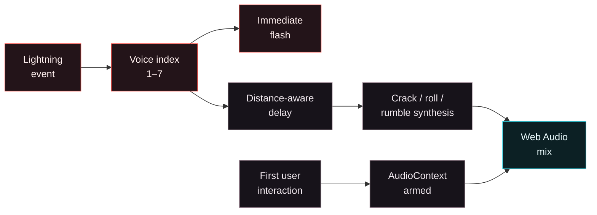
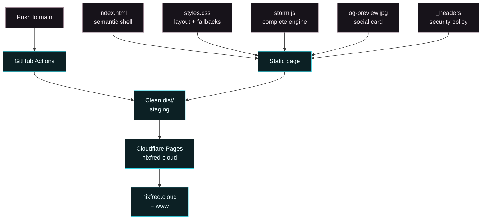

<p align="center">
  
</p>

<p align="center">
  <strong>A cloud that computes, and snows nix.</strong><br>
  Move the wind. Call the lightning. Operate the storm from a built-in terminal.
</p>

<p align="center">
  <a href="https://nixfred.cloud"><strong>Enter the storm</strong></a>
  ·
  <a href="#the-console">Open the operator manual</a>
</p>

# nixfred.cloud

`nixfred.cloud` is a single-page browser instrument built around a three-way
name: cloud infrastructure, a literal storm cloud, and *nix that falls as snow.
It boots like a machine, reacts like weather, and exposes its controls through
an embedded command line.

<p align="center">
  
</p>

The entire experience is hand-rolled in HTML, CSS, and JavaScript with **zero
runtime dependencies** and no build step.

## Four layers, one engine

The visual stack is deliberately separated by responsibility. WebGL renders
the volumetric field; a transparent 2D canvas carries the sharp effects and
interface-adjacent particles; the cold boot owns the opening beat; and semantic
HTML remains available above the weather.



### Storm cloud

The background is a WebGL fragment shader built from domain-warped fractional
Brownian motion. Pointer movement becomes wind: move to part the fog, swipe to
tear a gust, or hold and release to discharge lightning.

### Snow, lightning, and drift

The foreground canvas emits falling monospace nix glyphs, lets nearby flakes
respond to the cursor, and accumulates them into a drift. Lightning adds a
temporary precipitation burst and hands its strike identity to the audio
system.

### Constellation hub

Subdomains can orbit a glowing core as they come online. The whole mesh leans
toward input like a small gravity well; an empty fleet becomes the intentional
“awaiting nodes” state rather than an error.

### Cold boot

A one-time kernel-log and ASCII-cloud sequence introduces the system, then
stores its completion in `localStorage`. `reboot` clears that marker and plays
the sequence again.

## Input becomes weather



Audio arms only after the first interaction. Reduced-motion visitors bypass the
boot animation and receive a calm, static fallback; the page also contains a
`noscript` experience.

## The console

Press <kbd>`</kbd> or click the console hint. Commands mutate the same live state
used by the pointer-driven storm:

| Command | Effect |
|---|---|
| `storm rage \| calm \| auto` | Set the storm's energy policy |
| `lightning [1-7]` | Call a bolt; `1`–`7` selects a thunder voice |
| `snow on \| off \| auto` | Override or release precipitation |
| `mute` / `unmute` | Control synthesized storm audio |
| `ls`, `open <sub>` | Inspect and navigate the subdomain hub |
| `whoami`, `red`, `reboot`, `help` | Identity, machine lore, boot replay, and command reference |



The console is not decorative command-line copy. `storm`, `lightning`, `snow`,
and sound commands drive the running engine directly.

## Thunder without samples

Every sound is synthesized with the Web Audio API. Seven strike voices combine
different envelopes and noise treatments for a close crack, distant roll,
boomer, sizzle, rolling thunder, double crack, and deep grumble. Each flash is
paired with a delayed boom so distance still reads in an invented storm.



No audio files ship with the site.

## Repository anatomy



Core files:

- `index.html` contains metadata, accessible controls, boot/console markup, and fallbacks.
- `styles.css` defines the dark weather system, overlays, and reduced-motion behavior.
- `storm.js` contains the shader, particles, lightning, hub, boot, console, sharing, and audio.
- `_headers` carries the security headers used by the previous nginx deployment.

## Run locally

Serve the repository root with any static server:

```bash
python3 -m http.server 8000
```

Then open <http://localhost:8000>.

## Deployment

Pushes to `main` stage a clean `dist/` and deploy it to the `nixfred-cloud`
Cloudflare Pages project. The `nixfred.cloud` and `www.nixfred.cloud` custom
domains terminate DNS and TLS at Cloudflare; credentials remain in encrypted
repository secrets.

Manual fallback:

```bash
npx --yes wrangler@latest pages deploy . \
  --project-name nixfred-cloud \
  --branch main
```

The apex migrated from the former `red`/`blu` tunnel path on 2026-05-24. The
separate `*.nixfred.cloud` wildcard was not moved into Pages and remains outside
this repository's deployment scope.

© Fred Nix
