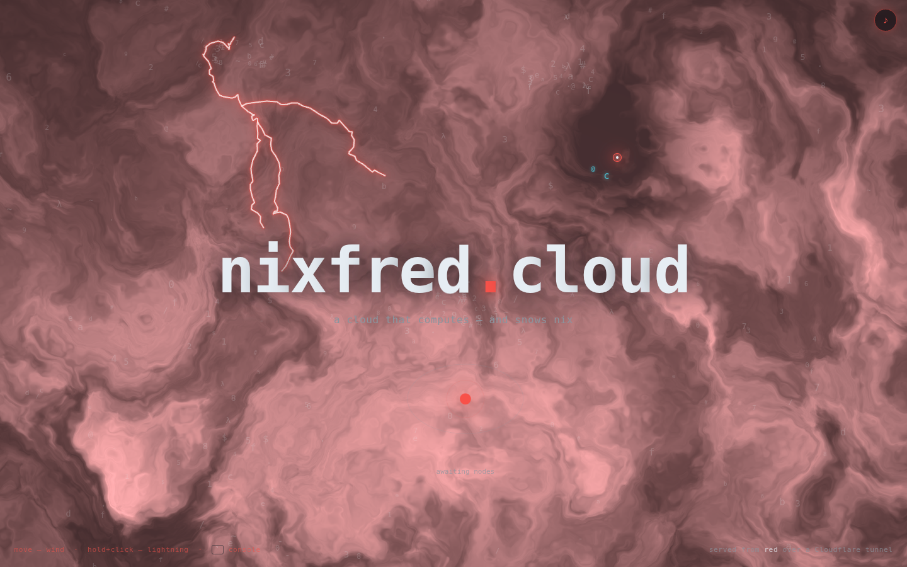

# nixfred.cloud

A storm you can operate — the landing page for **[nixfred.cloud](https://nixfred.cloud)**.
A single-page WebGL experience: a volumetric storm cloud that snows `/nix/store`
glyphs, throws lightning, rolls synthesized thunder, and answers to a built-in
`*nix` console.

## The idea

`nixfred.cloud` decodes three ways at once — a *cloud*, *nix* (snow, and `*nix`),
and a thing that *computes*. The page leans into all three: it boots like a
machine, it is a literal cloud, and it snows nix.

Four layers, one engine, hand-rolled with **zero dependencies**:

- **Storm cloud** — a WebGL fragment shader: domain-warped fbm noise. The cursor
  is wind — move it to part the fog, swipe to tear a gust.
- **Snow** — a particle system of falling monospace nix-glyphs that accumulate
  into a drift at the base. The cursor brightens and drags nearby flakes.
- **Constellation hub** — subdomains orbit a glowing core node; the mesh leans
  toward the cursor like a gravity well.
- **Cold boot** — a one-time `*nix` cold-open (kernel log + ASCII cloud),
  gated on `localStorage`.

## The console

Press `` ` `` (backtick), or click the hint, to open an embedded terminal.
Commands drive the weather:

| command | effect |
|---|---|
| `storm rage \| calm \| auto` | drive the storm's energy |
| `lightning [1-7]` | call down bolts — `1`-`7` picks one of 7 thunder voices |
| `snow on \| off \| auto` | force precipitation |
| `mute` / `unmute` | storm audio |
| `ls`, `open ` | the subdomain hub |
| `whoami`, `red`, `reboot`, `help` | identity, box, replay boot, command list |

## Audio

Thunder is fully synthesized — Web Audio, **no sample files**. Seven distinct
strike voices (close crack, distant roll, the boomer, sizzle, rolling thunder,
double-crack, deep grumble), each synced to its lightning flash with a realistic
flash-then-boom delay. Audio arms on first interaction.

## Build

No build step, no toolchain. Three files:

- `index.html` — markup
- `styles.css` — dark palette and layout
- `storm.js` — the whole engine (storm, snow, hub, boot, console, audio)

Served as static files. Respects `prefers-reduced-motion` with a calm static
fallback.

---

© Fred Nix.
